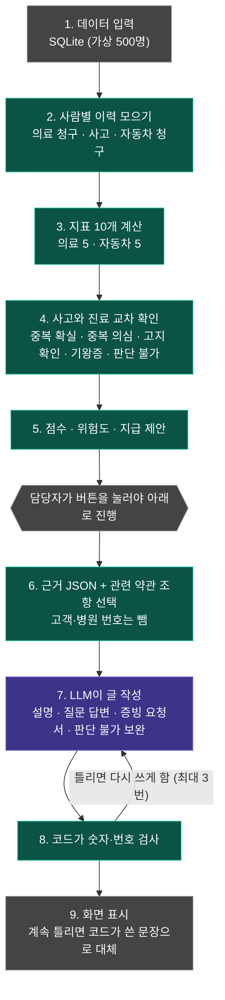

# InsureLens

**자동차 및 실손보험 이력 통합 기반 청구 심사 지원 시스템**
*A Claim Review Support System Integrating Auto and Indemnity Health Insurance Histories*

담당자가 한 사람을 조회하면 그 사람의 자동차보험과 실손의료보험 이력을 사람 기준으로 모아, **바로 지급해도 되는 건과 더 확인해야 하는 건을 나눠 주는** 청구 심사 지원 시스템입니다. 점수와 결과 제안은 코드가 정하고, LLM은 그 근거를 사람 말로 풀어 설명합니다. LLM이 쓴 숫자는 코드가 다시 검사하고, 지급 여부는 담당자가 결정합니다.

> 현재 결과물은 팀이 만든 **가상 데이터로 동작하는 프로토타입(POC)** 이며, 실제 보험사기 탐지 성능을 뜻하지 않습니다.

| 항목 | 내용 |
| --- | --- |
| 교과목 | AI P-실무프로젝트(캡스톤디자인), AI 4분반 8조 「팔각형 인재들」 |
| 기업 수요 주제 | 한국신용정보원 보험데이터부 인슈어테크팀 · 데이터 기반 의사결정 + LLM 설명 지원 (보험사기 예방) |
| 수행 기간 | 2026.9.1 ~ 2026.12.21 |
| 팀 | 장혁진 (LLM) · 김가현 (데이터) · 이은주 (계산 로직) · 김현수 (UI, 문서) |

---

## 목차

1. [왜 만들었나](#1-왜-만들었나)
2. [어떻게 동작하나](#2-어떻게-동작하나)
3. [빠른 시작](#3-빠른-시작)
4. [판정 규칙](#4-판정-규칙)
5. [LLM 기능](#5-llm-기능)
6. [데이터](#6-데이터)
7. [평가](#7-평가)
8. [프로젝트 구조](#8-프로젝트-구조)
9. [제약, 한계, 향후 계획](#9-제약-한계-향후-계획)
10. [그 밖의 화면](#10-그-밖의-화면)

---

## 1. 왜 만들었나

2025년 보험사기 적발금액은 1조 1,571억 원이고, 이 중 자동차보험이 5,724억 원입니다(금융감독원 발표). 부당하게 지급한 보험금은 되찾기 어려워 지급 전에 확인해야 하지만, 정상 고객의 지급을 늦추는 것도 문제입니다.

| 현행 방식 | 한계 |
| --- | --- |
| 영역별 분리 심사 | 자동차와 실손을 따로 보므로, 같은 치료비를 양쪽에서 받거나 사고 부상을 질병으로 청구해도 놓칩니다 |
| LLM 단독 활용 | 숫자를 잘못 인용하고, 같은 입력에도 결과가 달라질 수 있습니다 |
| 리포트·대시보드형 도구 | 지급할 건과 볼 건이 나뉘지 않아 담당자가 모든 건을 끝까지 읽어야 합니다 |

InsureLens는 역할을 나눠 이 문제를 풉니다.

- **계산은 코드**: 지표, 점수, 위험도, 지급 제안. 같은 입력이면 항상 같은 결과가 나옵니다.
- **해석은 LLM**: 걸린 지표와 교차 판정을 설명하고, 질문에 답하고, 증빙 요청서 초안을 씁니다. 점수는 바꾸지 않습니다.
- **검증은 코드**: LLM 답의 숫자와 청구 번호를 근거 데이터와 대조합니다.
- **결정은 사람**: 시스템은 자동으로 지급하지 않습니다.

---

## 2. 어떻게 동작하나



- **1~5단계는 전부 코드**입니다. SQLite 질의와 규칙 계산만 쓰고 LLM은 한 번도 호출하지 않습니다. 분석 개요, 검토 목록, 보고서 화면도 이 결과만으로 그립니다.
- **LLM은 담당자가 요청할 때만** 호출됩니다(로컬 모델 `gemma4:12b`).

### 화면 (`dist/person.html`)

| 탭 | 내용 |
| --- | --- |
| 검증 홈 | 데이터 현황, 위험도 분류별 인원, 분석 기준 조정, 데이터 변경 |
| 분석 개요 | 위험도 분포, 지표별·교차 판정별 인원, 월별 추이, AI 지표 해석 |
| 검토 대상 | 위험도 순 목록, 필터, CSV 내보내기 |
| 상세 조회 · AI 설명 | 한 사람의 이력 타임라인, 걸린 지표, 교차 판정, 지급 제안, LLM 설명·질문·요청서·보완, 관련 약관 |
| 분석 보고서 | 인쇄·PDF 저장용 보고서 |
| 검증 결과 | 정답표 대비 성능, SQL과 JS 계산 일치 여부 |

---

## 3. 빠른 시작

**필요한 것**: Node.js 24 이상, Python 3.10 이상, (LLM을 쓸 때) [Ollama](https://ollama.com)

```bash
git clone https://github.com/ieunjuee/p-project
cd p-project
npm ci --ignore-scripts      # 테스트용 jsdom만 설치합니다. 화면 실행에는 필요 없습니다
python3 data/build_db.py     # 가상 데이터 생성 (저장소에 이미 들어 있어 생략 가능)
npm start                    # http://localhost:4177/
```

브라우저에서 `http://localhost:4177/`를 열면 검증 홈으로 이동합니다. `dist/person.html`은 DB 파일을 불러오므로 파일을 더블클릭해서 열면 동작하지 않습니다. 반드시 `npm start`나 정적 서버로 여세요.

### LLM 연결 (선택)

LLM이 없어도 화면과 분석은 모두 동작합니다. 이때 설명은 코드가 만든 **데모 설명**으로 나옵니다.

```bash
ollama pull gemma4:12b                     # 약 8GB, GPU 12GB급 기준
OLLAMA_CONTEXT_LENGTH=8192 ollama serve    # 기본 4096은 근거 JSON이 긴 사람에게 모자랄 수 있습니다
# Windows PowerShell: $env:OLLAMA_CONTEXT_LENGTH=8192; ollama serve
cp .env.example .env                       # 모델이나 주소를 바꿀 때만 수정
npm start
```

| 환경변수 | 기본값 | 설명 |
| --- | --- | --- |
| `LLM_BASE_URL` | `http://localhost:11434/v1` | OpenAI 호환 주소. LM Studio, vLLM도 주소만 바꾸면 됩니다 |
| `LLM_MODEL` | `gemma4:12b` | GPU가 없는 노트북은 `qwen3:4b-instruct` 같은 작은 모델을 권합니다 |
| `LLM_API_KEY` | (비움) | 로컬 모델은 필요 없습니다 |
| `LLM_TIMEOUT_MS` | `120000` | CPU에서 돌릴 때는 늘리세요. 화면은 130초가 지나면 데모 설명으로 바뀝니다 |
| `LLM_MODE=demo` | (없음) | LLM을 부르지 않고 데모 설명만 씁니다 |
| `LLM_EXPLAIN_CAUSES=1` | (꺼짐) | 상세 설명에 원인 후보(causes)를 추가합니다(시험 전 문구) |

`.env`는 커밋하지 마세요(`.gitignore`에 포함).

### 검증 명령

```bash
npm test                          # 단위 테스트 103개
node tools/evaluate.mjs           # 정답표 대비 판정 성능 (개발용 500명)
python3 tools/eval_seeds.py       # 검증용 데이터 5세트(다른 seed, 2,000명, 위험 5%)로 평균·편차
python3 tools/verify_sql.py       # 엔진 계산값을 SQL로 다시 계산해 대조
node rag/eval/eval-search.mjs --test   # 약관 검색 평가 (검증용 32문항)
node tools/evaluate-llm.mjs --models gemma4:12b --persons 30   # LLM 모델 비교 (Ollama 필요)
```

---

## 4. 판정 규칙

### 지표 10개

| 구분 | 지표 | 걸리는 기준 (초안) |
| --- | --- | --- |
| 의료 | 진료 횟수 | 30일 안에 같은 병명 진료 8회 이상 |
| 의료 | 진료 간격 | 같은 병명 진료의 평균 간격 3일 미만 |
| 의료 | 진료비 | 같은 병명·치료 종류 집단에서 상위 5%인 청구가 여러 건 |
| 의료 | 반복 청구 | 같은 영수증 번호, 또는 같은 날·같은 병원·같은 금액 청구 반복 |
| 의료 | 병원 분산 | 짧은 기간에 같은 병명으로 여러 병원 이용 |
| 자동차 | 사고 횟수 | 90일 안에 사고 3건 이상 |
| 자동차 | 사고 간격 | 연속 사고 간격 30일 미만 |
| 자동차 | 치료 기간 | 같은 사고 유형(접촉 등) 집단에서 대인 치료 기간 상위 5% |
| 자동차 | 수리비 | 같은 사고 유형 집단에서 수리비 상위 5% |
| 자동차 | 반복 청구 | 같은 상대방·정비소 반복, 또는 같은 사고에 같은 종류 청구 반복 |

비교 집단이 최소 건수에 못 미치면 금액·기간 지표는 적용하지 않습니다.

### 교차 판정 5개 (자동차와 실손을 사람 기준으로 맞춰 봐야 보이는 유형)

| 판정 | 기준 | 위험도 영향 |
| --- | --- | --- |
| 중복 확실 | 같은 영수증 번호의 치료비가 자동차·실손 양쪽에서 지급됨 | 점수와 관계없이 **높음** |
| 중복 의심 | 영수증은 다르지만 같은 병원, 같은 치료 기간, 금액 차 5% 이내 | 최소 보통 |
| 고지 확인 | 사고 후 사고 부위를 치료받았는데 실손에는 질병으로 청구 | 최소 보통 |
| 기왕증 | 사고 전 90일 안에 같은 부위를 이미 치료받음 | 최소 보통 |
| 판단 불가 | 양쪽 영수증 번호가 비어 같은 비용인지 확인 불가 | **판단 불가**로 분리 |

### 점수, 위험도, 지급 제안

- 의료 점수 = 걸린 의료 지표 수 ÷ 5 × 100, 자동차 점수도 같은 방식. **종합 점수 = 두 점수 중 큰 값**
- 위험도: 30점 미만 낮음 · 30~60점 보통 · 60점 이상 높음 (교차 판정 규칙이 우선)

| 위험도 | 지급 제안 | 담당자에게 가는 것 |
| --- | --- | --- |
| 낮음 | 지급 | 바로 지급 권고 (최종 확인은 담당자) |
| 중복 확실 | 지급 정지 권고 | 중복 금액과 같은 영수증 근거 |
| 보통·높음 (중복 확실 제외) | 지급 보류 | 확인 항목, 증빙 요청서 초안 |
| 판단 불가 | 지급 보류 | 보완해야 할 자료 목록 |

부당 지급 비용이 정상 지급 지연 비용보다 훨씬 크다고 보고, 낮음이 아니면 모두 사람이 확인하도록 했습니다. 기준값(8회, 3일, 상위 5%, 30점, 60점)은 팀이 정한 초안이며, 검증 홈의 **분석 기준**에서 17개 기준값을 바꿔 전체를 다시 계산해 볼 수 있습니다.

지표와 교차 판정은 브라우저 안의 SQLite(sql.js, WASM)에서 SQL로 계산하고, 같은 계산을 JS(`person-engine.js`)로도 해서 500명 전원의 결과가 같은지 테스트합니다.

---

## 5. LLM 기능

LLM은 코드가 만든 근거 JSON(걸린 지표, 교차 판정, 금액, 날짜)만 받습니다. 고객 번호와 병원 번호는 빼고 보냅니다.

| 기능 | 화면 | 하는 일 |
| --- | --- | --- |
| 상세 설명 | 상세 조회 | 왜 이 위험도인지(근거)와 담당자가 확인할 항목을 씁니다 |
| 담당자 질문 | 상세 조회 | "왜 보류인가요?" 같은 질문에 근거 번호를 달아 답합니다. 근거에 없는 내용은 "근거가 없다"고 답합니다 |
| 증빙 요청서 초안 | 상세 조회 | 보류·정지 건에 고객에게 요청할 서류와 사유를 이메일 형식으로 씁니다. 발송은 담당자가 합니다 |
| 판단 불가 보완 | 상세 조회 | 무엇을 확인하면 판단할 수 있는지 정리합니다 |
| AI 지표 해석 | 분석 개요 | 전체 분포와 월별 추이를 해석하고 원인 후보와 권장 조치를 씁니다 |

### 환각 방지

- **수치 검증**(`verifyExplanation`): 답에 나온 숫자, 청구·사고 번호, 지표 이름이 근거에 있는지 코드가 대조합니다. 틀리면 틀린 값을 알려 주고 다시 쓰게 하며(최대 3번), 그래도 틀리면 코드가 만든 설명으로 대체합니다.
- **구조화 출력**: JSON 스키마, `temperature 0`, 생각 단계 끄기로 요청하고, 응답에 `<think>` 구간이 섞여도 무시합니다.
- **표현 가드**: 증빙 요청서에 내부 기준이나 압박 표현("의심", "사기" 등)이 들어가면 코드 기본 문구로 바꿉니다.

### 약관 RAG (관련 약관 조항 인용)

설명·질문 답변·요청서·보완에 관련 표준약관 조항을 함께 넣어, LLM이 **넣어 준 조항만** 인용하게 합니다. 약관은 인용에만 쓰고 점수·위험도·결과 제안은 바꾸지 않습니다.

- 원문: 「보험업감독업무시행세칙」 [별표15] 표준약관 중 자동차보험(개인용)과 실손의료보험(기본형, 특약1·2). 조항 단위 196조각(`rag/terms_chunks.jsonl`), 읽기용 원문은 `rag/terms_auto_silson.md`
- 조항 선택(코드): 교차 판정별 고정 매핑(예: 중복 → 실손 제4조, 기왕증 → 자동차 별표3) + 질문 검색(글자 2개 단위 BM25)
- 화면: 조항 이름, **이 건에 어떻게 적용되는지**(코드가 근거 데이터로 쓴 문장), 펼치면 조항 원문
- 검증: LLM이 고른 조항 번호(`term_refs`)가 넣어 준 조항 안에 있는지 확인

자세한 내용은 [`rag/README.md`](rag/README.md)를 보세요.

---

## 6. 데이터

실제 보험 청구 데이터는 개인신용정보라 쓸 수 없어, 자동차·실손 청구를 사람 단위로 재현한 **가상 데이터**를 직접 만들었습니다(`data/build_db.py`, seed 고정).

| 테이블 | 내용 |
| --- | --- |
| `person` | 사람 (가명 ID, 연령대, 성별) |
| `kcd_master` | 질병코드 10개 (손상 5: S13·S33·S93·S60·S80 / 질병 5: M54·M25·M75·J00·K21), 부위, 손상 여부 |
| `med_claim` | 실손 청구 (진료일, KCD, 외래·입원·물리치료, 병원, 영수증 번호, 청구·지급액, 상해/질병) |
| `auto_accident` | 자동차 사고 (사고일, 유형, 가해/피해, 과실비율, 상대방, 정비소) |
| `auto_claim` | 자동차 청구 (대물수리비·대인치료비·자차, 금액, 병원, 영수증 번호, 치료 시작·종료일) |
| `scenario_label` | 정답표 (평가 전용. **화면용 DB와 판정 코드는 읽지 않음**) |

정상인 사람을 먼저 만들고 일부에 부당 유형을 심었습니다. 규칙에 걸리지만 정상인 사람(함정)과, **현재 규칙의 경계 밖에 있어 일부러 못 잡게 만든 어려운 사례**도 넣었습니다. 규칙에 맞춘 사례만 넣으면 성능이 순환적으로 높게 나오기 때문입니다.

| 시나리오 | 구분 | 인원 (개발용) | 내용 | 규칙 기대 결과 |
| --- | --- | --- | --- | --- |
| 일반정상 | 정상 | 225 | 흩어진 일반 진료, 일부 경미 사고 | 낮음 |
| 정상분리청구 | 정상 | 40 | 사고 후 자동차는 수리비, 실손은 외래비로 비용이 겹치지 않음 | 낮음 |
| 잦은정상진료 | 정상(함정) | 35 | 만성 질환으로 자주 물리치료 | 보통 (규칙에 걸리는 정상) |
| 정상고액입원 | 정상(함정) | 10 | 질병으로 한 번 길게 입원해 금액이 큼 | 낮음 |
| 정상다병원이용 | 정상(함정) | 10 | 한 달 안에 서로 다른 질병으로 여러 병원 이용 (같은 병명은 2곳까지) | 낮음 |
| 경계정상 | 정상(함정) | 10 | 기준 바로 아래 (30일 7회·4일 간격 진료, 40~80일 간격 사고 2건) | 낮음 |
| 중복보상 | 위험 | 30 | 같은 영수증이 양쪽에서 지급 (일부는 영수증 번호 결측) | 높음 (결측은 판단 불가) |
| 고지누락 | 위험 | 25 | 사고 부상을 실손에 질병으로 청구 | 보통 |
| 경미사고과잉진료 | 위험 | 25 | 접촉 사고 후 긴 치료와 잦은 진료 | 높음 |
| 반복경미사고 | 위험 | 25 | 짧은 간격으로 접촉 사고 반복 | 높음 |
| 복합 | 위험 | 20 | 중복보상 + 반복경미사고 | 높음 |
| 기왕증 | 위험 | 15 | 사고 30~80일 전 같은 부위 진료 후 사고 손상 청구 | 보통 |
| 중복의심 | 위험 | 10 | 같은 병원·치료 기간, 영수증 다름, 금액 차 3% 이내 | 보통 |
| 중복금액차이 | 위험(어려운 사례) | 10 | 중복의심과 같으나 금액 차 8~15% | 낮음 (못 잡음) |
| 영수증분할중복 | 위험(어려운 사례) | 10 | 자동차 치료비 1건을 실손에 절반씩 2건으로 청구 | 낮음 (못 잡음) |

**개발용과 검증용을 나눕니다.** 기준값은 개발용(seed 20261022, 500명, 위험 34%)을 보며 정했으므로, 성능은 다른 seed로 만든 검증용 데이터(seed 20261120~20261124, 각 2,000명, 위험 5%)에서 잽니다.

```bash
python3 data/build_db.py --seed 20261120 --people 2000 --fraud-rate 0.05 --out data/test   # 검증용 1세트
node tools/evaluate.mjs data/test
```

`--out`을 주면 그 폴더에만 만들고 화면용 파일은 건드리지 않습니다. `data/test/`, `data/test_seeds/`는 커밋하지 않습니다.

기간은 2026-01-01 ~ 2026-09-30(273일)이고, 시나리오 비율과 기준값은 초안입니다.

---

## 7. 평가

### 판정 성능 (코드 판정, `tools/evaluate.mjs`, `tools/eval_seeds.py`)

| 기준 | 개발용 (500명, 위험 34%) | 검증용 (2,000명 × seed 5개, 위험 5%) |
| --- | --- | --- |
| "높음" 정밀도 | 0.958 | 0.695 ± 0.019 (0.671~0.714) |
| "높음" 재현율 | 0.541 | 0.556 |
| 위험 사례 중 확인 대상 (높음·보통·판단 불가) | 88.2% | 90.9% |
| 정상 사례 중 확인 대상 (심사 부담) | 10.9% | 10.8% |
| 위험한데 "낮음"(바로 지급) | 20명 | 9명 |

- 위험 사례 중 "보통"(고지누락, 기왕증, 중복의심)은 설계상 담당자 확인으로 넘기므로 놓친 것이 아닙니다. "높음" 재현율이 낮은 주된 이유입니다.
- "낮음"으로 빠진 위험 사례는 **모두 일부러 넣은 어려운 사례**(중복금액차이, 영수증분할중복)입니다.
- 오탐은 모두 함정 시나리오 중 잦은정상진료입니다. 진료 횟수 지표가 만성 질환의 정상 치료와 과잉 진료를 구분하지 못합니다. 다른 함정 3종(정상고액입원, 정상다병원이용, 경계정상)은 모두 "낮음"으로 바로 지급됩니다. Baseline에서 LLM 단독이 정상의 약 30%를 의심한 것과 대비됩니다.
- 위험 비율이 높으면 정밀도가 실제보다 좋게 나옵니다. 그래서 검증용은 위험 비율을 5%로 낮췄고, `evaluate.mjs`는 어떤 데이터든 **위험 비율 5%로 환산한 정밀도**를 함께 출력합니다(개발용 0.701).

### Baseline 비교 (평가용 모의 데이터 v2, 1,200명, 21개 유형, gemma4:12b)

| | 방식 |
| --- | --- |
| 우리 시스템 | 지표 10개 + 교차 판정을 코드로 계산 (LLM은 설명만) |
| A 영역별 분리 | 같은 코드에서 교차 판정만 끔 (의료·자동차를 따로 평가) |
| B1 LLM 단독 (원본만) | 한 사람의 원본 청구 이력만 주고 위험도 4단계를 판정하게 함 |
| B2 LLM 단독 (원본+규칙표) | B1에 우리 규칙 설명표를 함께 줌 (가장 공정한 LLM 단독) |

| 지표 | 우리 시스템 | A 영역별 분리 | B1 | B2 |
| --- | --- | --- | --- | --- |
| 위험 사례 "높음" (재현율) | 40.9% | 25.3% | 44.3% | **49.2%** |
| 위험 사례 확인 대상 (높음+보통) | 78.9% | 35.2% | 75.5% | **97.1%** |
| 위험 사례 "낮음" (누락) | 14.8% | 64.8% | 24.5% | **2.9%** |
| 정상 사례 "높음" (오탐) | **0.8%** | **0.8%** | 7.7% | 6.3% |
| 정상 사례 확인 대상 (심사 부담) | 6.2% | **6.1%** | 29.7% | 29.0% |
| 정상 사례 바로 지급 | 93.8% | **93.9%** | 60.4% | 61.0% |
| 위험 비율 5%로 환산한 "높음" 정밀도* | **약 73%** | 약 63% | 약 23% | 약 29% |
| 건당 처리 시간 | 수 ms | 수 ms | 1.4초 | 1.5초 |

\* 재현율과 오탐률로 계산한 값입니다(정밀도 = 재현율×5% ÷ (재현율×5% + 오탐률×95%)). v2의 위험 비율은 32%로 실제보다 높게 설계되어 있습니다.

- **탐지율은 LLM 단독이 약간 앞섭니다.** 허위장기입원, 병원쇼핑처럼 규칙에 없는 상식적 의심은 LLM이 잡습니다.
- **오탐과 심사 부담은 우리 시스템이 크게 낮습니다.** LLM 단독은 정상 사례의 약 30%를 사람이 다시 봐야 하고, 위험 사례가 드문 실제 비율에서는 "높음" 판정의 70% 이상이 정상입니다.
- **Baseline A와의 차이는 교차 판정**(중복보상, 고지누락, 기왕증은닉, 중복의심형)에서 나옵니다. 다만 이 유형은 우리가 데이터에 심은 것이라 구조상 정해진 결과입니다.
- 규칙표를 줘도 LLM은 규칙을 정확히 따르지 못했습니다(B2와 코드 판정 일치 65.6%).
- 다음 개선 방향은 "LLM이 의심 사례를 넓게 찾고, 코드가 기준 계산과 교차 판정으로 검증하는" 결합 구조입니다(미측정).

한계: 정답과 데이터를 팀이 만들었고, 모델·프롬프트는 각각 하나이며, 같은 유형의 사람이 거의 복제라 독립 시험 수는 약 21개입니다. 평가용 데이터만 측정했고 결과를 보고 기준값을 고치지 않았습니다.

### LLM 모델 선정 (`tools/evaluate-llm.mjs`, 같은 과제 52건씩 자동 채점)

| 기준 | qwen3:14b | qwen3.5:9b (수정 프롬프트) | **gemma4:12b (수정 프롬프트)** |
| --- | --- | --- | --- |
| 숫자 환각률 | 3.7% | 0.3% | **0.0%** |
| 걸린 지표의 근거 번호 인용 | 30/40 | 40/40 | **40/40** |
| 요약문에 걸린 지표 이름 | 45% | 95% | **100%** |
| 지급 확정 등 단정 표현 | 7건 | 0건 | **0건** |
| 응답 시간 중앙값 (GPU) | 4.3초 | 2.9초 | **2.0초** |
| 모델 크기 | 9.3GB | 6.6GB | 8.0GB |

신뢰성(환각 0%, 인용 만점)과 속도가 가장 좋은 `gemma4:12b`를 기본 모델로 정했습니다. 자동 채점에는 글자 매칭이 섞여 있어, 해석이 업무적으로 맞는지는 사람이 봐야 합니다.

### 약관 검색 (`node rag/eval/eval-search.mjs --test`, 검증용 32문항)

| 방식 | Hit@1 | Hit@2 | MRR@5 | 약관 밖 질문 거름 |
| --- | --- | --- | --- | --- |
| 제목 매칭 | 4% | 19% | 0.12 | 0% |
| 단어 BM25 | 33% | 41% | 0.43 | 0% |
| **글자 2개 BM25 (현재)** | **78%** | **78%** | **0.81** | **80%** |

검증용 문항은 개선 전에 따로 떼어 두고 개선에 쓰지 않았습니다.

---

## 8. 프로젝트 구조

```
p-project/
├── data/
│   ├── schema.sql            # SQLite 6개 테이블
│   ├── build_db.py           # 가상 데이터 생성 → data/insure.db, dist/data/* (--out 으로 검증용)
│   └── insure.db             # 정답표 포함 DB (평가용)
├── dist/                     # 브라우저에서 실행되는 화면
│   ├── person.html           # 메인 화면 (사람 단위)
│   ├── person-app.js         # 화면 6개 탭
│   ├── person-sql.js         # 화면이 쓰는 계산 (SQLite 쿼리)
│   ├── person-engine.js      # 점수·위험도·결과 제안, LLM 근거, 수치 검증 (JS 대조 계산)
│   ├── indicator-engine.js   # 분석 개요 AI 지표 해석용 근거 계산·검증
│   ├── data/                 # 화면용 DB(정답표 제외), mock.json, labels.json
│   └── vendor/               # sql.js (WASM)
├── server.mjs                # 정적 파일 + LLM API (/api/explain-person, /api/person-assist, /api/interpret-overview)
├── person-llm.mjs            # 상세 설명·질문·요청서·보완 LLM 호출과 재생성
├── indicator-llm.mjs         # 분석 개요 AI 지표 해석 LLM 호출
├── terms-rag.mjs             # 약관 조항 선택 (고정 매핑 + 검색)
├── rag/                      # 약관 원문(md), 조각, 생성 스크립트, 검색 평가
├── tools/
│   ├── evaluate.mjs          # 정답표 대비 판정 성능 (데이터 폴더 지정 가능)
│   ├── eval_seeds.py         # 검증용 데이터 여러 seed 반복 평가
│   ├── evaluate-llm.mjs      # LLM 모델 비교
│   └── verify_sql.py         # SQL 교차 검증
├── tests/                    # 단위 테스트 (node --test)
└── backend/, dist/aura.*     # AURA 2.0 프로토타입 (10장 참고)
```

### 테스트

```bash
npm test
```

계산(지표 경계값, 30일 창, 판단 불가), 데이터 생성 옵션(--out, --fraud-rate, seed 재현성, 함정 시나리오), SQL과 JS 결과 일치(500명 전원), 정답표 분리, LLM 요청 형식과 응답 검증, 지어낸 숫자 탐지, 약관 조항 인용 제한, 화면 상태 전환까지 103개를 검사합니다. GitHub Actions(`.github/workflows/check.yml`)가 push와 PR마다 실행합니다. DOM 테스트는 실제 브라우저 배치 검증을 대신하지 않습니다.

---

## 9. 제약, 한계, 향후 계획

### 산학 멘토링에서 확인한 제약과 우리 가정

| 제약 | 우리 가정과 대응 |
| --- | --- |
| 개인신용정보는 망분리된 내부망에만 있어 외부 상용 LLM 연결 불가 | 로컬에서 실행하는 오픈소스 LLM(`gemma4:12b`) 사용 |
| 조회는 개인 동의 기반, 관련자 실명 제공 불가 | 가명 ID만 사용, LLM에는 고객·병원 번호를 보내지 않음 |
| 일반신용정보(대출·연체)와 보험신용정보는 교차 활용 불가 | 보험 정보(자동차·실손)만 사용 |
| 건강보험·심평원 진료 데이터 연계 불가 | 보험 청구 정보만으로 판정 |
| 실제 신정원 데이터 사용 불가 | 팀이 만든 가상 데이터로 구현·평가 |

### 한계

- 가상 데이터와 정답표를 팀이 직접 설계했으므로, 성능 수치는 실제 탐지 성능이 아닙니다.
- 기준값과 위험도 경계는 초안입니다. 멘토링에서 실무용 기준표는 따로 없고 자체 정의해도 된다는 답을 받았습니다.
- 진료 횟수 지표는 만성 질환의 정상 치료와 과잉 진료를 구분하지 못해 함정 시나리오에서 오탐이 납니다.
- 금액 차이가 5%를 넘는 중복, 한 번의 치료비를 나눠 청구한 경우(청구쪼개기), 허위 장기입원, 병원쇼핑처럼 규칙에 없는 유형은 현재 규칙으로 잡지 못합니다.
- CPU에서는 LLM 설명 1건에 2~3분이 걸려 GPU 환경이 필요합니다.

### 실데이터 구조 검증 (신정원 맞춤형 모의DB)

한국신용정보원 AI 러닝 플랫폼의 맞춤형 모의DB로 실제 데이터 구조에 적용할 수 있는지 확인했습니다. 차주일련번호로 자동차·실손 청구를 사람 단위로 연결할 수 있었고, 판정 항목 15개 중 10개를 그대로 또는 대체 기준으로 적용할 수 있었습니다. 진단코드, 영수증 번호, 병원, 일 단위 날짜가 없어 중복 확실·고지 확인·치료 기간 등 5개는 적용할 수 없었습니다. 모의DB는 구조 파악용 가상 데이터라 성능 근거로는 쓰지 않았고, 모의DB 원본은 저장소에 올리지 않습니다.

### 향후 계획

- 맞춤형DB(실제 가명 데이터) 원격분석 환경에서 같은 규칙을 실측
- 실손 청구 전산화 데이터 연계로 영수증 번호·진단코드 기반 판정 강화
- LLM이 의심 사례를 넓게 찾고 코드가 검증하는 결합 구조 시험
- 같은 기간·병원 안 실손 청구 합계와 자동차 치료비를 비교하는 규칙(나눠 청구한 중복 대응)

---

## 10. 그 밖의 화면

| 화면 | 설명 |
| --- | --- |
| `dist/legacy.html` | 초기 청구 단위 데모. CSV 업로드, 규칙 + JavaScript Isolation Forest 점수, 차트, 청구별 설명. 파일을 더블클릭해도 설치 없이 열립니다. `/api/explain`은 `OPENAI_API_KEY`가 있을 때만 실제 LLM을 씁니다 |
| `dist/aura.html`, `backend/` | AURA 2.0 프로토타입(FastAPI + PostgreSQL/SQLite, 도구 호출 에이전트). `npm run start:backend`, `npm run test:backend`로 실행합니다. 진행 상황은 `IMPLEMENTATION_STATUS.md`에 있습니다 |

GitHub Pages(`https://ieunjuee.github.io/p-project/`)는 정적 파일만 제공하므로 LLM 기능은 데모 설명으로 동작합니다.

---

## 참고

- 금융감독원 2025년 보험사기 적발 실적 (경향신문, 2026.3.31) — https://www.khan.co.kr/article/202603312103005/
- 상법 제658조(보험금액의 지급)
- 「보험업감독업무시행세칙」 [별표15] 표준약관, 국가법령정보센터
- 한국신용정보원 AI 러닝 플랫폼 (ailp.kcredit.or.kr)

이 저장소의 데이터는 모두 가상 데이터입니다. 멘토 제공 자료와 신정원 모의DB는 포함하지 않습니다.
